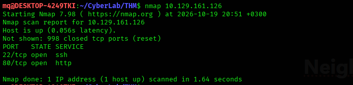
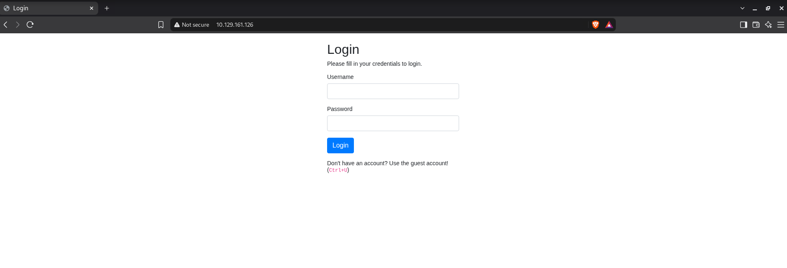
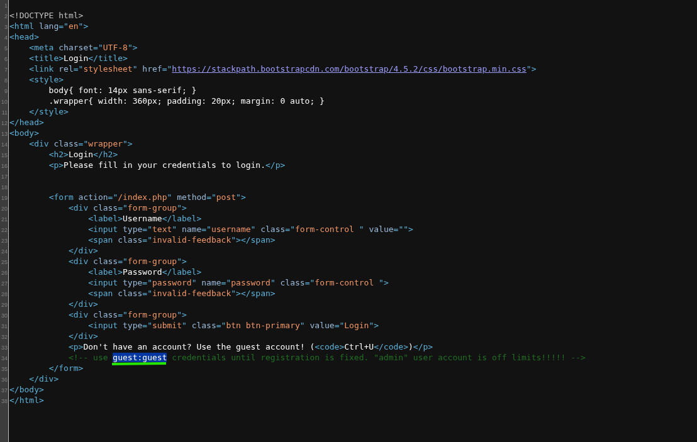
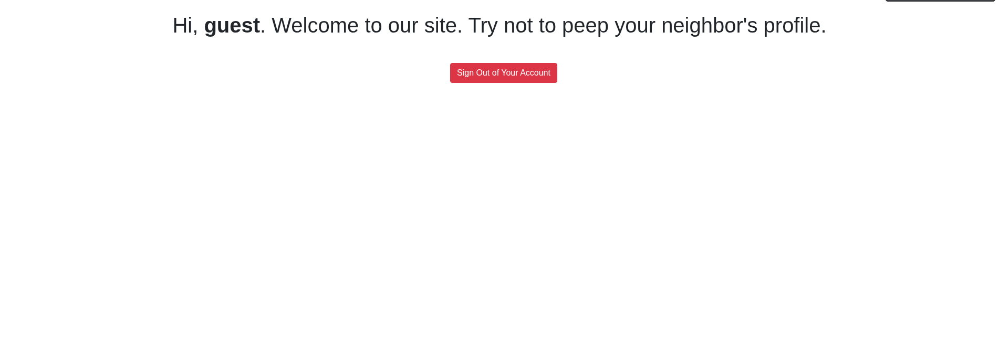
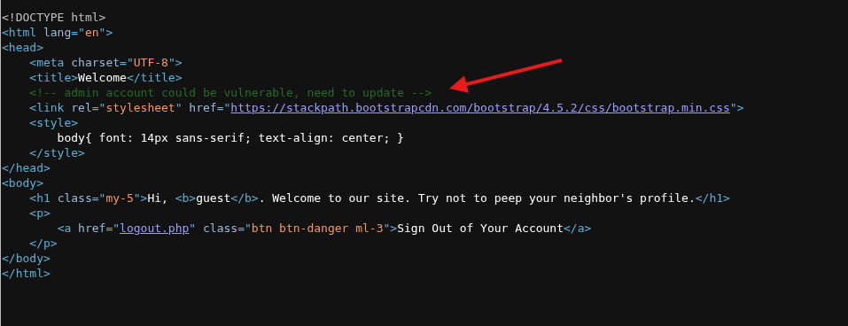
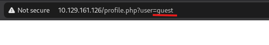
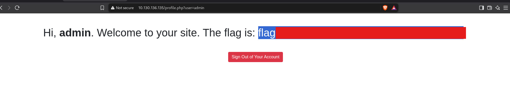

# Neighbour — TryHackMe Walkthrough

[](https://tryhackme.com/room/neighbour)
[]()
[]()


A walkthrough of the **Neighbour** room on TryHackMe — a web challenge built around a fictional "Authentication Anywhere" login service, demonstrating an **Insecure Direct Object Reference (IDOR)** vulnerability.

**Room:** https://tryhackme.com/room/neighbour

---

## Scenario

The target hosts a cloud login service: *"Check out our new cloud service, Authentication Anywhere — log in from anywhere you'd like! Users can enter their username and password, for a totally secure login process. You definitely wouldn't be able to find any secrets that other people have in their profile, right?"*

That last line is the hint.

---

## Walkthrough

### 1. Recon

A port scan on the target showed only port `80` open (HTTP).



Opening the site in the browser:



### 2. Viewing the page source

Using `Ctrl+U` to view the page source:



The login form accepted the default guest credentials `guest:guest`:



### 3. Spotting the IDOR

After logging in as `guest`, viewing the page source again:



...revealed a hidden comment:



> `admin account could be vulnerable, need to update`

This was found while the profile URL was pointing at the `guest` user:

```
http://<ip>/profile.php?user=guest
```

Changing the `user` parameter from `guest` to `admin`:

```
http://<ip>/profile.php?user=admin
```

With the actual target IP:

```
http://10.130.136.135/profile.php?user=admin
```



This confirmed the vulnerability: the application never checks whether the logged-in user is authorized to view the profile referenced by the `user` parameter — it just returns whatever profile is asked for.

---

## Root Cause

This is a textbook **Insecure Direct Object Reference (IDOR)**: the app exposes an internal identifier (`user=<username>`) directly in the URL and trusts it without verifying that the requesting session actually owns that resource. Any authenticated user — even a guest account — can pivot to another account's data just by changing a parameter.

**Fix:** enforce server-side authorization on every object reference (check that the session's user matches the requested resource, or use unpredictable/opaque IDs plus an access-control check) rather than relying on the client not to guess the parameter.

---

## Skills Demonstrated

| Stage | Skill |
|-------|-------|
| Recon | Port scanning, manual web browsing |
| Analysis | Reading page source for hidden comments/hints |
| Exploitation | Identifying and exploiting an IDOR via parameter tampering |
| Reporting | Root-cause analysis and remediation guidance |

---

## Disclaimer

This walkthrough documents work performed on a deliberately vulnerable TryHackMe lab machine for educational purposes. None of the techniques here should be used against systems you do not own or have explicit written permission to test.
